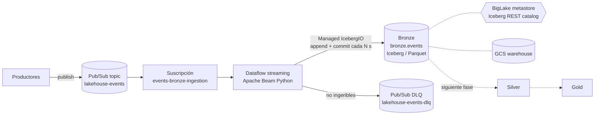

# demo_caso_practico1 — Plataforma de datos Lakehouse (arquitectura Medallion) en GCP

Plataforma de datos con arquitectura **lakehouse medallion** (Bronze → Silver → Gold)
sobre **Apache Iceberg** en Google Cloud, con dos flujos de ingesta:

| Flujo | Estado | Descripción |
|---|---|---|
| 1. Streaming (eventos) | **Implementado** | Pub/Sub → Dataflow (Apache Beam) → Bronze (Iceberg) |
| 2. Pendiente de definir | — | — |

## Arquitectura del flujo streaming



- **Broker de eventos:** Pub/Sub. La suscripción guarda 7 días de mensajes,
  incluidos los ya confirmados (`retain_acked_messages`), para poder hacer *seek*
  y reprocesar.
- **Procesamiento:** Dataflow con Apache Beam **2.77.0** (SDK de Python). La
  escritura a Iceberg usa **Managed I/O** (`beam.managed.Write(beam.managed.ICEBERG)`),
  que por debajo es `IcebergIO` de Java usado como transform cross-language.
- **Formato de tabla:** Apache Iceberg, con ficheros de datos en Parquet y GCS
  como almacenamiento.
- **Catálogo:** BigLake metastore como *Iceberg REST catalog*, con
  *credential vending*.

### Capa Bronze: `bronze.events`

Bronze guarda el evento **tal cual llega**, más metadatos técnicos. Aquí no se
aplica ningún esquema de negocio; eso se hace en Silver.

| Columna | Tipo Iceberg | Origen |
|---|---|---|
| `event_id` | string (req.) | atributo/campo `event_id`; si no viene, el `message_id` de Pub/Sub |
| `event_type` | string | atributo/campo `event_type` |
| `event_source` | string | atributo/campo `event_source` |
| `event_timestamp` | timestamptz | atributo/campo `event_timestamp` (ISO 8601 o epoch en ms) |
| `payload` | string (req.) | cuerpo del mensaje en crudo (UTF-8) |
| `is_valid_json` | boolean (req.) | si el payload es un JSON válido |
| `attributes` | map<string,string> | atributos de Pub/Sub |
| `pubsub_message_id` | string (req.) | id de mensaje de Pub/Sub |
| `publish_time` | timestamptz (req.) | hora de publicación en Pub/Sub |
| `ingestion_time` | timestamptz (req.) | hora de procesamiento en Dataflow |

- **Particionado:** `day(publish_time)`. Uso la hora de publicación y no la de
  ingesta porque un mensaje conserva su `publish_time` si se reprocesa.
- **Calidad en Bronze:** un JSON inválido **no se descarta**: se guarda con
  `is_valid_json = false`. A la DLQ solo van los mensajes cuyo cuerpo no es
  UTF-8 o que provocan un error inesperado. El mensaje se reenvía íntegro y se le
  añaden los atributos `dlq_reason` y `dlq_error`.
- **Duplicados:** Pub/Sub entrega *at-least-once*, así que Bronze puede tener
  duplicados. La deduplicación por `event_id` queda para Silver.

## Estructura del repositorio

```
streaming/                     Job de ingesta streaming (Beam/Dataflow)
  bronze_ingestion/
    schema.py                  Esquema de la fila Bronze (NamedTuple -> Row)
    transforms.py              PubsubMessage -> BronzeEvent + DLQ
    iceberg_config.py          Configuración Managed Iceberg (biglake / hadoop)
    pipeline.py                Opciones y construcción del pipeline
  main.py                      Punto de entrada
  setup.py                     Empaquetado para los workers de Dataflow
  scripts/
    run_local.sh               Ejecución local sin GCP (catálogo hadoop)
    run_dataflow.sh            Lanzamiento en Dataflow
    publish_test_events.py     Publica eventos de prueba en Pub/Sub
    inspect_local_table.py     Lee la tabla local con PyIceberg
  tests/                       Tests unitarios (pytest)
infra/terraform/               Pub/Sub, GCS, catálogo BigLake Iceberg, IAM
```

## Puesta en marcha

### 1. Pruebas y ejecución local (sin GCP)

Requisitos: Python 3.10 o superior y Java 11 o superior. Java hace falta porque
Beam descarga y arranca el *expansion service* de IcebergIO.

```bash
cd streaming
python -m venv .venv && source .venv/bin/activate
pip install -r requirements-dev.txt
pytest
./scripts/run_local.sh                       # escribe ./.local_warehouse/bronze/events
pip install pyiceberg pyarrow
python scripts/inspect_local_table.py ./.local_warehouse
```

### 2. Infraestructura en GCP

```bash
cd infra/terraform
cp terraform.tfvars.example terraform.tfvars   # rellena project_id
terraform init && terraform apply
```

Se crea lo siguiente:

- APIs habilitadas.
- Un bucket de warehouse y otro para Dataflow.
- El catálogo `google_biglake_iceberg_catalog` (tipo `CATALOG_TYPE_GCS_BUCKET`).
- El topic de eventos con su suscripción, y el topic de DLQ con la suya.
- La cuenta de servicio de Dataflow con permisos mínimos sobre cada recurso.

### 3. Lanzar el job y enviar eventos

```bash
cd streaming
PROJECT_ID=mi-proyecto REGION=europe-west1 ./scripts/run_dataflow.sh
python scripts/publish_test_events.py --project mi-proyecto --count 20
```

Si no existen, el job crea el namespace `bronze` y la tabla `bronze.events`.
Hace commit de un snapshot cada `--triggering_frequency_seconds` (60 s por
defecto). Con un valor más bajo los datos se ven antes, pero se generan más
ficheros pequeños y más snapshots.

## Qué está verificado y qué no

- **Verificado en este repo:**
  - Los tests unitarios de la transformación y de la configuración.
  - Una ejecución local real con Beam 2.77.0, que escribe una tabla Iceberg con
    catálogo `hadoop`. La tabla se ha leído después con PyIceberg: esquema,
    particionado y filas son correctos.
  - La construcción del grafo en modo streaming (Pub/Sub + catálogo BigLake),
    sin ejecutarlo.
  - `terraform validate` con el provider `hashicorp/google` 8.6.0.
- **No verificado (no hay proyecto de GCP en este entorno):**
  - La ejecución en Dataflow.
  - La conexión real al catálogo REST de BigLake.
  - `terraform apply`.

  Las propiedades del catálogo BigLake son las del test de integración oficial
  de Beam 2.77.0. Los roles IAM salen de la documentación del provider de
  Terraform. Conviene validar ambos en el primer despliegue.
